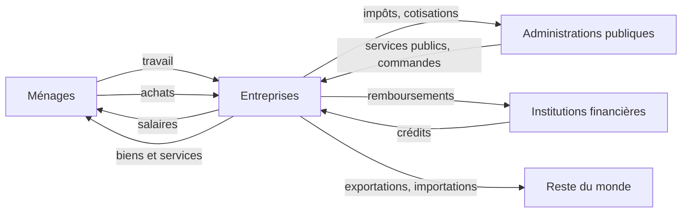
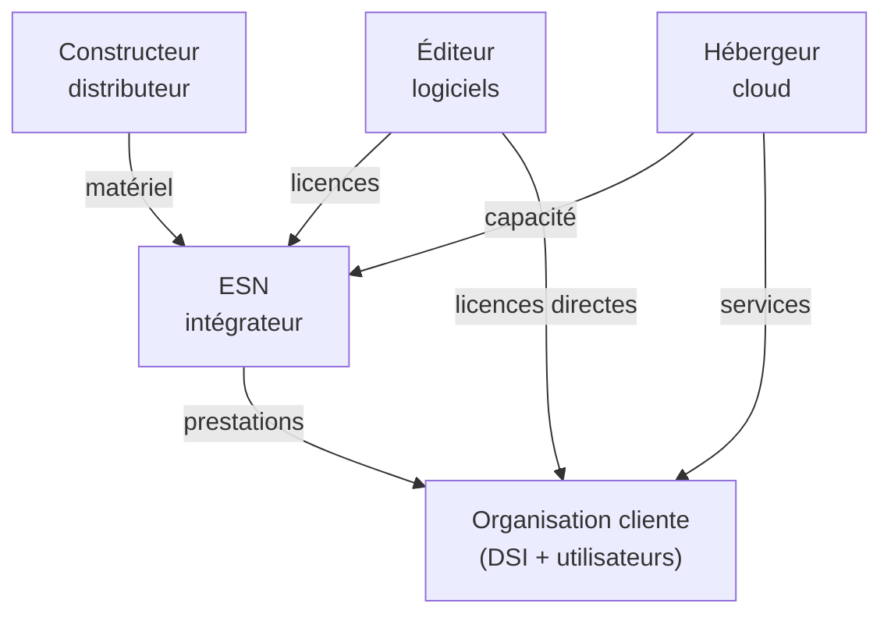

# Cours – Agents économiques, acteurs du numérique et modèles économiques

*BTS SIO SISR 1re année – CEJMA – S01 – à lire avant l'[étude de cas](02-etude-de-cas.md)*

> [!NOTE] Ce que tu dois savoir déjà
> - **Prérequis :** Aucun

## À la fin de ce cours tu sauras

- [ ] Nommer les **agents économiques** et décrire leurs échanges
- [ ] Distinguer **DSI, éditeur, ESN, hébergeur, distributeur**
- [ ] Comparer **régie, forfait et infogérance** et dire qui porte le risque
- [ ] Décrire les principaux **modèles économiques** du numérique
- [ ] Calculer et comparer des coûts sur plusieurs années

## I. Les agents économiques et leurs échanges

Une **entreprise** ne vit pas seule : elle échange avec d'autres. L'économie regroupe ces acteurs en cinq grandes familles, les **agents économiques**.

| Agent | Rôle principal | Exemple dans le numérique |
|---|---|---|
| **Ménages** | Consomment, travaillent, épargnent | Un particulier abonné à une messagerie en ligne |
| **Entreprises** | Produisent des biens et des services | Une ESN, un éditeur de logiciels, une PME cliente |
| **Administrations publiques** | Règlent, redistribuent, fournissent des services publics | Une mairie, un ministère, la CNIL |
| **Institutions financières** | Collectent l'épargne, accordent des crédits | Une banque qui finance l'achat d'un parc de serveurs |
| **Reste du monde** | Échangent avec l'économie nationale | Un éditeur américain qui vend ses licences en France |

Ces agents échangent des **flux réels** (biens, services, travail) et des **flux financiers** (paiements, crédits, impôts).

> [!NOTE]
> L'entreprise **cliente** peut être elle-même un ménage (on parle de **B to C**), une autre entreprise (**B to B**), une administration (**B to G**). Entre particuliers, c'est du **C to C**.

## II. L'écosystème des services numériques

Dans le monde de l'informatique, les entreprises se répartissent des **rôles** complémentaires.

| Acteur | Ce qu'il fait | D'où vient son revenu | Exemple de poste |
|---|---|---|---|
| **DSI** (direction des systèmes d'information) | Gère le système d'information **de sa propre organisation** | Budget interne de l'organisation | Technicien support, administrateur |
| **Éditeur de logiciels** | Conçoit et commercialise des logiciels | Licences, abonnements, maintenance | Développeur, support éditeur |
| **ESN** (entreprise de services du numérique) | Vend des **prestations** à d'autres organisations : conseil, intégration, infogérance, maintenance | Prestations facturées à ses clients | Consultant, technicien, chef de projet |
| **Constructeur et distributeur** | Fabriquent ou revendent du matériel | Ventes de matériel, services associés | Technicien avant-vente |
| **Hébergeur et fournisseur de cloud** | Louent de la capacité de calcul, de stockage, de réseau | Abonnements, facturation à l'usage | Exploitant de datacenter |
| **Opérateur et fournisseur d'accès** | Fournissent la connectivité | Abonnements | Technicien réseau |

Le sigle **ESN** remplace l'ancien sigle SSII (société de services en ingénierie informatique). On la qualifie aussi d'entreprise **prestataire** : elle intervient pour le compte d'un **client**.

### Où se situe ton entreprise d'alternance ?

Elle est l'un de ces acteurs. Pour la situer, pose trois questions :

1. **Vend-elle** des prestations informatiques à d'autres (ESN) ou **utilise-t-elle** l'informatique pour son propre métier (DSI d'une organisation) ?
2. **Qui est son client**, et qui sont ses **fournisseurs** (éditeurs, hébergeurs, distributeurs) ?
3. **Comment est-elle payée** ou comment finance-t-elle son service informatique ?

## III. La relation client – prestataire

Quand une ESN intervient chez un client, trois formes de prestations sont fréquentes.

| Forme | Principe | Qui dirige le travail ? | Qui porte le risque de dérive ? | Obligation du prestataire |
|---|---|---|---|---|
| **Régie** (assistance technique) | Le prestataire met des **personnes à disposition** pour un temps donné ; facturation au **temps passé** (jours) | Le **client** | Le **client** (il paie le temps passé) | De **moyens** |
| **Forfait** | Un **résultat** est promis pour un **prix fixe** | Le **prestataire** | Le **prestataire** (le prix est fixe) | De **résultat** |
| **Infogérance** (tierce maintenance) | Le prestataire prend en charge l'exploitation d'un ensemble de services selon un **niveau de service** contractuel | Le **prestataire** | Partagé, selon le contrat | De **résultat**, selon les engagements |

> [!NOTE]
> **Obligation de moyens** : le prestataire s'engage à faire de son mieux, sans garantir le résultat. **Obligation de résultat** : il s'engage à atteindre un résultat précis ; s'il n'est pas atteint, sa responsabilité est engagée sans qu'on lui reproche une faute. Cette distinction revient en séance 4 (contrats) et en séance 7 (responsabilités).

**Le prix d'une journée en régie** s'appelle le **TJM** (taux journalier moyen). Il couvre le coût du salarié (salaire, charges, frais) **et** les coûts de structure de l'ESN (commerciaux, locaux, gestion), plus sa **marge**.

> [!WARNING]
> En régie, le client ne peut pas donner d'ordres au salarié de l'ESN **comme s'il était son propre employé** : le salarié reste sous l'**autorité de son employeur**. Le Code du travail interdit le **prêt de main-d'œuvre à but lucratif** hors cadres autorisés (article L8241-1) et le **marchandage** (article L8231-1). Une régie conforme est une prestation de service réelle, qui apporte une **compétence**, avec un contrat précisant la mission.

## IV. Les modèles économiques du numérique

| Modèle | Principe | Exemple d'usage |
|---|---|---|
| **Licence** | Le client paie pour obtenir le **droit d'utiliser** un logiciel (souvent avec maintenance annuelle) | Poste de travail sous licence propriétaire |
| **Abonnement (SaaS)** | Le client **loue** un service accessible par Internet, facturé par mois ou par utilisateur | Messagerie, suite bureautique en ligne |
| **Open source et services** | Le logiciel est libre ; l'éditeur ou l'ESN vend le **support**, l'intégration, la formation | Système d'exploitation libre accompagné d'un contrat de support |
| **Freemium** | Une version gratuite attire, une version payante apporte plus de fonctions | Outil de supervision avec une version limitée |
| **Plateforme** | Une place de marché met en relation offreurs et demandeurs et prend une **commission** | Boutique d'applications |
| **Prestation** | Le client paie un **service** : temps, projet, niveau de service | Régie, forfait, infogérance |

### Ce qui change avec le numérique

- **Du capital vers l'usage** : on **loue** plutôt qu'on **achète** (cloud, abonnements). Les dépenses d'investissement deviennent des dépenses de fonctionnement.
- **Des effets de réseau** : plus un service a d'utilisateurs, plus il a de valeur pour chacun. Cela favorise des acteurs très grands (voir séance 2).
- **Une dépendance** : changer de fournisseur peut être coûteux (formats propriétaires, migration). C'est le **verrouillage** (*lock-in*).

## V. Un exemple chiffré : régie ou forfait ?

Une ESN fictive facture un client pour migrer des postes. Données :

- coût complet d'un consultant pour l'ESN : **390 €** par jour travaillé (salaire, charges, frais de structure) ;
- mission prévue : **2 consultants × 20 jours = 40 jours** ;
- en **régie** : TJM de **480 €** ; en **forfait** : prix fixe de **21 500 €**.

| | Régie | Forfait |
|---|---|---|
| Prix payé par le client (charge prévue) | 40 × 480 = **19 200 €** | **21 500 €** |
| Coût pour l'ESN (charge prévue) | 40 × 390 = **15 600 €** | **15 600 €** |
| Marge de l'ESN | **3 600 €** (18,75 % du prix) | **5 900 €** (27,4 % du prix) |
| Si la charge dépasse de **30 %** : prix payé par le client | 19 200 × 1,3 = **24 960 €** | **21 500 €** (inchangé) |
| Si la charge dépasse de **30 %** : coût pour l'ESN | 15 600 × 1,3 = **20 280 €** | **20 280 €** |
| Si la charge dépasse de **30 %** : marge de l'ESN | **4 680 €** (18,75 %) | **1 220 €** (5,7 %) |

**Lecture.** En régie, la dérive est payée par le **client** et l'ESN garde sa marge. En forfait, la dérive est supportée par l'**ESN**, dont la marge s'effondre. Le forfait est plus cher au départ (21 500 € contre 19 200 €) mais protège le client **si le projet dérape** ; la régie est moins chère si tout va bien.

## À retenir

- Cinq agents économiques : **ménages, entreprises, administrations, institutions financières, reste du monde** ; ils échangent des flux réels et financiers.
- Un **écosystème** : DSI, éditeurs, ESN, constructeurs et distributeurs, hébergeurs, opérateurs.
- **Régie** (temps passé, obligation de moyens, risque pour le client), **forfait** (résultat, prix fixe, risque pour le prestataire), **infogérance** (niveau de service).
- Modèles économiques : **licence**, **abonnement (SaaS)**, **open source et services**, **freemium**, **plateforme**, **prestation**.
- Le numérique pousse à **louer plutôt qu'acheter** et crée des **dépendances** (verrouillage).
