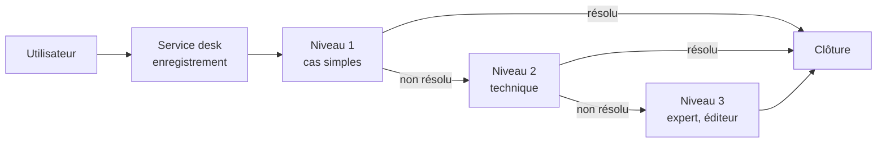

# Cours – Ressources, organisation, management et service de support

*BTS SIO SISR 1re année – CEJMA – S08 – à lire avant l'[étude de cas](02-etude-de-cas.md)*

> [!NOTE] Ce que tu dois savoir déjà
> - **Prérequis :** S03 (indicateurs), S05 (faire ou faire-faire)

## À la fin de ce cours tu sauras

- [ ] Classer les **ressources** et décrire les **compétences**
- [ ] Distinguer **structures** et **mécanismes de coordination**
- [ ] Reconnaître les **niveaux** et les **styles** de management
- [ ] Décrire le **service desk** et les **niveaux N1, N2, N3**
- [ ] Calculer l'effet d'une amélioration du niveau 1 sur le coût

## I. Les ressources de l'entreprise

Pour fonctionner, une entreprise mobilise des **ressources**, qu'elle doit **organiser**.

| Type | Définition | Exemples dans un service informatique |
|---|---|---|
| **Tangibles** (matérielles) | On peut les **toucher** | Serveurs, postes, réseau, locaux |
| **Intangibles** (immatérielles) | On ne les touche pas, mais elles ont de la **valeur** | Logiciels, bases de connaissances, marque, **savoir-faire**, brevets, données |
| **Humaines** | Les personnes et leurs **compétences** | Techniciens, experts, responsable |
| **Financières** | Moyens de payer et d'investir | Budget, trésorerie |

Une **compétence** est la capacité à **mobiliser** des connaissances, des savoir-faire et des comportements pour réussir une tâche. Une organisation **combine** ressources et compétences pour créer un **avantage** durable.

## II. Organiser : structure, coordination, contrôle

### La structure

La **structure** répartit le travail et les responsabilités.

| Structure | Principe | Avantage | Limite |
|---|---|---|---|
| **Fonctionnelle** | Services par **fonction** (production, commercial, informatique…) | Expertise, clarté | Cloisonnement |
| **Divisionnelle** | Une unité par **produit, marché ou zone** | Proche du client | Doublons |
| **Matricielle** | Chaque personne dépend d'un **chef de fonction** et d'un **chef de projet** | Souplesse, projets | Double hiérarchie, conflits |

### Les mécanismes de coordination

Quand plusieurs personnes travaillent ensemble, il faut les **coordonner**. Mintzberg distingue cinq mécanismes :

| Mécanisme | Principe | Exemple |
|---|---|---|
| **Ajustement mutuel** | Les personnes se coordonnent par **échange direct** | Deux techniciens qui se répartissent un incident |
| **Supervision directe** | Un **chef** donne des ordres | Le responsable affecte les tickets |
| **Standardisation des procédés** | On suit la **même procédure** | Procédure d'escalade |
| **Standardisation des résultats** | On fixe les **résultats attendus** | Objectif de 90 % de tickets résolus dans le délai |
| **Standardisation des qualifications** | On s'appuie sur des **formations** communes | Certification de technicien |

### Le contrôle

Le **contrôle** compare les **résultats** aux **objectifs** et déclenche des **actions correctives** (voir les indicateurs de la séance 3).

## III. Manager : niveaux et styles

### Les trois niveaux

| Niveau | Décisions | Horizon | Exemple |
|---|---|---|---|
| **Stratégique** | Orientations globales | Long terme | Choisir de passer au cloud |
| **Tactique** (intermédiaire) | Mise en œuvre des orientations | Moyen terme | Planifier la migration |
| **Opérationnel** | Activités du quotidien | Court terme | Traiter un ticket |

### Les styles de management

| Style | Qui décide ? | Atout | Risque |
|---|---|---|---|
| **Autoritaire** | Le **chef seul**, sans expliquer | Rapide | Démotivation |
| **Persuasif** | Le chef décide, mais **explique** pour convaincre | Adhésion | Participation limitée |
| **Participatif** | Le chef **consulte** l'équipe et décide ensemble | Implication, qualité | Plus lent |
| **Délégatif** | L'équipe **décide** dans un cadre fixé | Autonomie | Risque de dérive sans suivi |

Il n'y a **pas de style idéal** : le choix dépend de la **situation** (urgence, maturité de l'équipe, enjeu).

## IV. Application : organiser un service de support

### Le référentiel ITIL

**ITIL** est un **référentiel de bonnes pratiques** de gestion des services informatiques. Il organise le travail en **pratiques** (gestion des incidents, des problèmes, des changements, des demandes, des niveaux de service…) autour d'un point d'entrée unique : le **service desk**.

### Le service desk et le point de contact unique

Le **service desk** (centre de services, ou **help desk**) est l'interface entre les **utilisateurs** et la DSI : un **point de contact unique** (SPOC) enregistre **tous** les incidents et demandes (téléphone, courriel, portail).

### Les niveaux de support

| Niveau | Rôle | Compétence | Exemples |
|---|---|---|---|
| **N1** | **Accueil**, enregistrement, diagnostic initial, résolution des cas **simples** (procédures, scripts) | Généraliste | Réinitialiser un mot de passe, configurer une imprimante |
| **N2** | Résolution des cas **techniques** | Technicien confirmé | Dépanner un serveur de fichiers, un problème réseau |
| **N3** | Cas **complexes**, **expertise**, lien avec les éditeurs et constructeurs, correction de fond | Expert, architecte | Défaut logiciel, problème d'infrastructure |

L'**escalade** peut être **fonctionnelle** (on passe à un niveau plus expert) ou **hiérarchique** (on prévient un responsable quand l'enjeu ou le délai l'exige).

### Exemple chiffré : le coût par niveau

Un support traite **1 200 tickets** par mois. Coût moyen d'un ticket : **12 €** en N1, **45 €** en N2, **130 €** en N3.

| | **Situation actuelle** | **Avec une base de connaissances** |
|---|---|---|
| Tickets résolus en N1 | 70 % = **840** | 80 % = **960** |
| Tickets résolus en N2 | 22 % = **264** | 16 % = **192** |
| Tickets résolus en N3 | 8 % = **96** | 4 % = **48** |
| Coût N1 | 840 × 12 = **10 080 €** | 960 × 12 = **11 520 €** |
| Coût N2 | 264 × 45 = **11 880 €** | 192 × 45 = **8 640 €** |
| Coût N3 | 96 × 130 = **12 480 €** | 48 × 130 = **6 240 €** |
| **Total** | **34 440 €** (28,70 € par ticket) | **26 400 €** (22 € par ticket) |

Économie : 34 440 − 26 400 = **8 040 € par mois**, soit **23,3 %**. L'idée : faire **monter le taux de résolution du niveau 1** grâce aux **procédures** et à la **base de connaissances** (standardisation des procédés), plus économique.

## À retenir

- **Ressources** tangibles, intangibles, humaines, financières ; **compétences** = mobiliser savoirs, savoir-faire, comportements.
- **Structures** fonctionnelle, divisionnelle, matricielle ; **coordination** : ajustement mutuel, supervision directe, standardisation des procédés, des résultats, des qualifications.
- **Niveaux** de management : stratégique, tactique, opérationnel ; **styles** : autoritaire, persuasif, participatif, délégatif ; pas de style idéal.
- **ITIL** : référentiel de bonnes pratiques ; **service desk** = point de contact unique ; **N1, N2, N3** + **escalade**.
- Améliorer le **niveau 1** (procédures, base de connaissances) **réduit le coût**.
