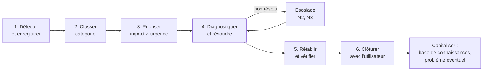

# Cours – Gestion des incidents : processus, priorités, SLA et indicateurs

*BTS SIO SISR 1re année – CEJMA – S09 – à lire avant l'[étude de cas](02-etude-de-cas.md)*

> [!NOTE] Ce que tu dois savoir déjà
> - **Prérequis :** S03 (indicateurs), S08 (service desk, niveaux de support)

## À la fin de ce cours tu sauras

- [ ] Distinguer **incident, problème, demande, changement**
- [ ] Décrire les **étapes du processus** et rédiger un **ticket** utile
- [ ] Appliquer la **matrice impact × urgence** et un **SLA**
- [ ] Calculer **taux de respect, MTTR, disponibilité**
- [ ] Expliquer l'**effet d'expérience** et le **retour d'expérience**

## I. Le vocabulaire

| Terme | Définition | Exemple |
|---|---|---|
| **Incident** | **Interruption** ou **dégradation** non prévue d'un service | L'ERP est inaccessible |
| **Demande de service** | Demande **prévue** et **standard** d'un utilisateur | Commander un écran, créer un compte |
| **Problème** | **Cause** (inconnue) d'un ou plusieurs incidents | Un pilote réseau défectueux provoque des coupures répétées |
| **Changement** | Ajout, modification ou retrait d'un élément du système | Mise à jour d'un serveur |
| **Ticket** | **Fiche de suivi** d'un incident ou d'une demande | Numéro, date, description, priorité, historique |

> [!NOTE]
> On **résout** d'abord l'**incident** (rétablir vite le service) puis on traite le **problème** (supprimer la cause pour éviter qu'il se reproduise).

## II. Le processus de traitement d'un incident

Un **processus** est une **suite d'activités organisées** qui transforme des **entrées** en **résultats** de valeur pour le client.

À chaque étape, on **communique** avec l'utilisateur (accusé de réception, point d'avancement, clôture).

### Les informations d'un bon ticket

**Qui** a signalé, **quand**, **quoi** (symptôme observé, message d'erreur, capture), **où** (poste, service, site), **depuis quand**, **ce qui a changé**, **impact** (combien de personnes ?), **actions déjà tentées**.

## III. Prioriser : impact et urgence

- **Impact** : **combien** de personnes ou de services sont touchés ?
- **Urgence** : **dans quel délai** faut-il agir ?

| Impact ↓ / Urgence → | **Haute** | **Moyenne** | **Basse** |
|---|---|---|---|
| **Élevé** (plusieurs services, service critique) | **P1** | **P2** | **P3** |
| **Moyen** (un service, un groupe) | **P2** | **P3** | **P4** |
| **Faible** (un utilisateur) | **P3** | **P4** | **P4** |

## IV. Les engagements de service

Le **SLA** (*service level agreement*) est l'**accord de niveau de service** : il fixe des engagements mesurables pour chaque priorité.

| Sigle | Sens |
|---|---|
| **GTI** | **Garantie de temps d'intervention** : délai de **prise en charge** |
| **GTR** | **Garantie de temps de rétablissement** : délai pour **rétablir** le service |

Exemple de grille (en heures **ouvrées**) :

| Priorité | GTI | GTR |
|---|---|---|
| **P1** | 15 minutes | **4 h** |
| **P2** | 1 h | **8 h** |
| **P3** | 4 h | **24 h** |
| **P4** | 8 h | **72 h** |

Les heures **ouvrées** ne comptent que les heures d'ouverture du service (par exemple 8 h–18 h, du lundi au vendredi).

## V. Mesurer le processus

| Indicateur | Calcul | Remarque |
|---|---|---|
| **Taux de respect du SLA** | tickets dans les délais ÷ tickets traités × 100 | Par priorité |
| **MTTR** (*mean time to repair*, temps moyen de réparation) | somme des durées de rétablissement ÷ nombre d'incidents | Plus il baisse, mieux c'est |
| **MTBF** (*mean time between failures*, temps moyen entre pannes) | durée de fonctionnement ÷ nombre de pannes | Plus il augmente, mieux c'est |
| **Disponibilité** | (temps total − arrêt) ÷ temps total, ou **MTBF ÷ (MTBF + MTTR)** | Exprimée en % |

Exemple : MTBF de 720 h et MTTR de 4 h : disponibilité = 720 ÷ 724 = **99,45 %**.

## VI. L'effet d'expérience

Plus on **répète** une activité, plus on devient **efficace**. L'**effet d'expérience** désigne la **baisse du coût unitaire** à mesure que la **production cumulée** augmente. On le modélise parfois par une **courbe à 80 %** : à chaque **doublement** de la production cumulée, le coût unitaire est multiplié par 0,8.

| Production cumulée | 1 | 2 | 4 | 8 |
|---|---|---|---|---|
| **Coût unitaire** (base 100) | 100 | **80** | **64** | **51,2** |

Dans un support, la **base de connaissances**, les **procédures** et la **formation** transforment l'expérience individuelle en **expérience collective**.

## VII. Incident majeur et incident de sécurité

- **Incident majeur** : impact très fort (service critique indisponible) : on **active une cellule de crise**, on désigne un **responsable de l'incident** et un **porte-parole**, on **informe** régulièrement la direction et les utilisateurs.
- **Incident de sécurité** : atteinte à la **confidentialité**, l'**intégrité** ou la **disponibilité** (attaque, fuite). Il suit un processus voisin avec des étapes supplémentaires : **isoler**, **préserver les preuves** (séance 18), **notifier** si des données personnelles sont concernées (séance 15).
- Après un incident majeur, on fait un **retour d'expérience** (analyse **sans chercher de coupable**) : chronologie, causes, ce qui a bien fonctionné, actions d'amélioration.

## À retenir

- **Incident** (rétablir), **problème** (supprimer la cause), **demande** (prévue), **changement** (modification).
- Processus : enregistrer, classer, **prioriser (impact × urgence)**, diagnostiquer, escalader, rétablir, **clôturer**, **capitaliser**.
- **SLA**, **GTI**, **GTR** ; indicateurs : respect du SLA, **MTTR**, **MTBF**, **disponibilité**.
- **Effet d'expérience** : le coût unitaire baisse quand la production cumulée augmente.
- **Incident majeur** : cellule de crise ; **retour d'expérience** sans chercher de coupable.
