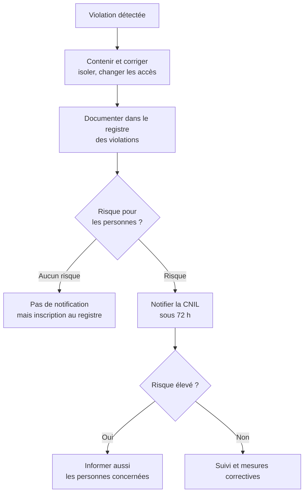

# Cours – RGPD : sécurité, violations de données, AIPD et sanctions

*BTS SIO SISR 1re année – CEJMA – S15 – à lire avant l'[étude de cas](02-etude-de-cas.md)*

> [!NOTE] Ce que tu dois savoir déjà
> - **Prérequis :** S13, S14, S07

## À la fin de ce cours tu sauras

- [ ] Citer des mesures de **sécurité** adaptées
- [ ] Appliquer la règle des **72 heures**
- [ ] Décider d'**informer** les personnes
- [ ] Citer les **pouvoirs** et **sanctions** de la CNIL
- [ ] Proposer des **mesures correctives**

## I. Sécuriser les données (article 32)

Le responsable de traitement et le sous-traitant doivent mettre en œuvre des mesures **techniques et organisationnelles appropriées** au **risque**, en tenant compte de l'état de l'art, des coûts, de la nature des données et de la gravité des risques pour les personnes.

| Famille | Exemples |
|---|---|
| **Pseudonymisation et chiffrement** | Disques chiffrés, communications chiffrées |
| **Confidentialité** | Gestion des droits, authentification forte, cloisonnement |
| **Intégrité et disponibilité** | Sauvegardes testées, plan de reprise |
| **Résilience** | Mises à jour, supervision, tests réguliers |
| **Organisation** | Charte, sensibilisation, procédures, habilitations (séance 11) |

> [!NOTE]
> Il n'existe pas de liste fermée de mesures : on **adapte au risque** et on **documente** ses choix (principe de responsabilité).

## II. La violation de données

Une **violation de données personnelles** est une atteinte à la **confidentialité**, à l'**intégrité** ou à la **disponibilité** de données, **accidentelle ou illicite** : vol d'ordinateur, rançongiciel, envoi d'un fichier au mauvais destinataire, perte de clé USB, accès abusif d'un salarié.

### Que faire ?

| Étape | Règle |
|---|---|
| **Notification à la CNIL** | Dans les **72 heures** après en avoir pris **connaissance**, sauf si la violation n'engendre **aucun risque** pour les personnes (articles 33) |
| **Information des personnes** | **Sans retard injustifié** si le risque est **élevé** (article 34), sauf données rendues inintelligibles (chiffrement) |
| **Sous-traitant** | Doit alerter le responsable **dans les meilleurs délais** |
| **Registre des violations** | **Toutes** les violations sont documentées, même non notifiées |

La notification peut être faite **en plusieurs temps** si toutes les informations ne sont pas encore connues : mieux vaut notifier à temps que parfaitement.

### Évaluer la gravité

On croise : **type de données** (sensibles ?), **nombre** de personnes, **facilité d'identification**, **conséquences** (fraude, atteinte à la réputation, discrimination), **mesures de protection** existantes (chiffrement).

## III. L'analyse d'impact (AIPD)

Une **analyse d'impact** (article 35) est requise lorsque le traitement est **susceptible d'engendrer un risque élevé**. La CNIL publie une **liste** de traitements concernés ; des critères reviennent : données **sensibles**, **grande échelle**, **surveillance systématique**, **personnes vulnérables**, croisement de données, nouvelles technologies. En pratique, **deux critères** réunis suffisent souvent à justifier une AIPD.

## IV. La CNIL et les sanctions

### Les pouvoirs de la CNIL

| Pouvoir | Exemples |
|---|---|
| **Conseiller** | Guides, modèles, réponses aux organisations |
| **Contrôler** | Sur place, sur pièces, en ligne, sur convocation |
| **Mettre en demeure** | Demander une mise en conformité dans un délai |
| **Sanctionner** | Avertissement, rappel à l'ordre, limitation ou interdiction du traitement, **amende**, publication |

### Les amendes administratives

| Niveau | Plafond | Exemples de manquements |
|---|---|---|
| **Niveau 1** | **10 M€ ou 2 %** du chiffre d'affaires mondial (le plus élevé) | Défaut de sécurité, de registre, de contrat de sous-traitance, de notification de violation |
| **Niveau 2** | **20 M€ ou 4 %** du chiffre d'affaires mondial | Violation des principes de base, des droits des personnes, des transferts |

La sanction est **proportionnée** : gravité, durée, nombre de personnes, intentionnalité, coopération, mesures prises.

### Autres responsabilités

- **Civile** : réparation du préjudice des personnes (séance 7).
- **Pénale** : le Code pénal punit certains manquements (collecte déloyale, absence de mesures de sécurité, détournement de finalité, accès frauduleux : articles 226-16 et suivants et 323-1 et suivants, à vérifier).
- **Image** : une violation médiatisée coûte parfois plus cher que l'amende.

## V. Le rôle du technicien

L'administrateur ou le technicien est souvent **le premier à voir** une violation : il doit **savoir qui prévenir** (DPO, RSSI, direction), **préserver les preuves** (séance 18) et **ne rien effacer** qui serve à l'enquête.

## À retenir

- Sécurité **adaptée au risque** (article 32), documentée.
- Violation : **contenir**, **documenter**, **notifier la CNIL sous 72 h** si risque, **informer** les personnes si risque **élevé**.
- Toutes les violations sont inscrites au **registre**.
- **AIPD** pour les traitements à risque élevé.
- Amendes : **10 M€ / 2 %** ou **20 M€ / 4 %**.
