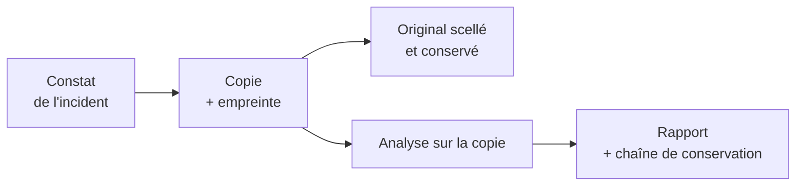

# Cours – Preuve électronique, signature et identité numérique

*BTS SIO SISR 1re année – CEJMA – S18 – à lire avant l'[étude de cas](02-etude-de-cas.md)*

> [!NOTE] Ce que tu dois savoir déjà
> - **Prérequis :** S11, S15

## À la fin de ce cours tu sauras

- [ ] Citer les conditions de l'**écrit électronique**
- [ ] Distinguer les niveaux de **signature**
- [ ] Appliquer la **chaîne de conservation**
- [ ] Distinguer **identifier** et **authentifier**
- [ ] Respecter la **loyauté** de la preuve

## I. La preuve en droit

Quand un litige naît (contrat contesté, faute reprochée, intrusion), il faut **prouver**. Le régime de la preuve dépend du domaine.

| Domaine | Principe |
|---|---|
| **Civil** (contrats, consommation) | Preuve **écrite** pour les actes d'un certain montant, sinon liberté de preuve ; règles du Code civil |
| **Commercial** (entre commerçants) | **Liberté de la preuve** |
| **Pénal** | **Liberté de la preuve**, mais la preuve doit être **obtenue loyalement** |
| **Travail** | Liberté de la preuve, avec le respect de la **vie privée** et de la **loyauté** (séance 11) |

## II. L'écrit et la signature électroniques

| Notion | Règle |
|---|---|
| **Écrit électronique** | Admis comme preuve **s'il permet d'identifier son auteur** et s'il est établi et conservé dans des conditions qui en **garantissent l'intégrité** (Code civil, article 1366) |
| **Signature électronique** | Manifeste le **consentement** ; fiabilité présumée si procédé conforme (Code civil, article 1367) |
| **Règlement eIDAS** (UE 910/2014) | Trois niveaux : **simple**, **avancée**, **qualifiée** ; la signature qualifiée a la **même valeur** qu'une signature manuscrite |
| **Horodatage** | Prouve qu'un document existait à une date donnée |
| **Cachet électronique** | Équivalent pour les personnes morales |

> [!NOTE]
> Un simple courriel peut servir de preuve, mais sa **force** dépend de la possibilité d'**identifier l'auteur** et de prouver que le contenu n'a pas été **modifié**.

## III. Les preuves numériques en pratique

| Preuve | Qualité nécessaire | Bonnes pratiques |
|---|---|---|
| **Journaux** (logs) | Horodatés, **intègres**, **complets** | Horloge synchronisée (NTP), centralisation, droits en écriture limités |
| **Courriels** | En-têtes complets, intégrité | Conserver l'**original** (format source) |
| **Captures d'écran** | Limitée seule | Compléter par un **constat** |
| **Disques et fichiers** | Intégrité démontrable | Copie **bit à bit**, **empreinte** (hash) avant et après |
| **Pages web** | Contenu évolutif | **Constat de commissaire de justice**, outils d'archivage horodaté |

### La chaîne de conservation

Pour qu'une preuve soit **recevable et crédible** :

1. **Identifier** ce qu'on conserve et où ;
2. **Préserver** sans altérer : copie de travail, original intact, **empreinte** (SHA-256) ;
3. **Documenter** qui a accédé, quand, pourquoi (**chaîne de conservation**) ;
4. **Conserver** dans un lieu sûr, accès limité ;
5. **Présenter** avec les explications nécessaires.

> [!WARNING]
> **Ne jamais travailler sur l'original.** Une preuve modifiée, sans traçabilité, peut être écartée, et le technicien est accusé d'avoir altéré des éléments.

## IV. L'identité numérique

L'**identité numérique** est l'ensemble des **traces** et des **données** associées à une personne en ligne : comptes, publications, profils, historique, avis.

### Identifier et authentifier

| Notion | Sens |
|---|---|
| **Identification** | Dire qui l'on est |
| **Authentification** | **Prouver** que l'on est bien cette personne (mot de passe, second facteur, certificat) |
| **Fédération d'identité** | Utiliser une identité existante pour se connecter ailleurs (ex. : FranceConnect) |

### E-réputation et droits

- **E-réputation** : image d'une personne ou d'une entreprise sur Internet. Les avis et publications comptent.
- **Droit à l'effacement** et **déréférencement** : demander la suppression de données ou le retrait d'un résultat de recherche (RGPD, séance 14).
- **Usurpation d'identité** : utiliser l'identité d'autrui pour nuire ou obtenir un avantage est une **infraction** (Code pénal, article 226-4-1, à vérifier).

### Pour l'entreprise

Politique d'**identités et d'accès** (un compte par personne, gestion des départs), **communication** maîtrisée, **veille** sur sa réputation, **réponse** aux avis.

## À retenir

- **Liberté de la preuve** en matière commerciale et pénale, mais **loyauté** exigée.
- **Écrit électronique** : **auteur identifié** et **intégrité** garantie (art. 1366) ; signature **qualifiée** = valeur de la signature manuscrite (eIDAS).
- Preuve numérique : **copie + empreinte**, **chaîne de conservation**, **jamais sur l'original**.
- **Identité numérique** : identifier ≠ authentifier ; e-réputation ; effacement ; usurpation punissable.
