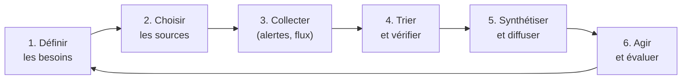

# Cours – Veille juridique et technologique, méthode de traitement d'un dossier

*BTS SIO SISR 1re année – CEJMA – S19 – à lire avant l'[étude de cas](02-etude-de-cas.md)*

> [!NOTE] Ce que tu dois savoir déjà
> - **Prérequis :** S01 à S18

## À la fin de ce cours tu sauras

- [ ] Mettre en place une **veille** organisée
- [ ] Choisir des **sources** fiables
- [ ] Rédiger un **bulletin** de veille
- [ ] Appliquer la **méthode** de réponse en trois temps
- [ ] Réaliser un sujet de **synthèse**

## I. Pourquoi une veille juridique et technologique ?

Les règles et les menaces **évoluent** : nouveaux textes, décisions, vulnérabilités, outils. Une **veille** est un processus **organisé** pour repérer, trier et exploiter l'information utile, afin de **décider** et d'**agir** à temps.

## II. La démarche de veille

| Étape | Questions à se poser |
|---|---|
| **Besoins** | Pour qui ? Sur quels sujets (RGPD, cybersécurité, licences, marchés) ? Quelles décisions en dépendent ? |
| **Sources** | Fiables ? À jour ? Officielles ? |
| **Collecte** | Outils : flux **RSS**, alertes courriel, newsletters, réseaux professionnels |
| **Tri** | Pertinent ? Vérifié ? Daté ? Doublon ? |
| **Synthèse** | Bulletin court : fait, impact, action, échéance |
| **Action** | Mettre à jour une procédure, un contrat, une charte |
| **Évaluation** | Les sources sont-elles utiles ? Le rythme convient-il ? |

## III. Des sources fiables

| Domaine | Sources |
|---|---|
| **Droit** | Légifrance, EUR-Lex, Cour de cassation, Conseil d'État |
| **Données personnelles** | CNIL |
| **Cybersécurité** | ANSSI, CERT-FR, Cybermalveillance.gouv.fr |
| **Propriété intellectuelle** | INPI |
| **Économie, entreprise** | Insee, Bpifrance Création, ministère de l'Économie |
| **Vulnérabilités** | Bulletins CERT-FR, bases de CVE |

> [!NOTE]
> Une information doit être **datée**, **sourcée** et **recoupée**. Un blog ou un réseau social sert de **signal**, pas de **preuve**.

## IV. Diffuser et rendre exploitable

Un **bulletin de veille** tient en une page :

| Rubrique | Contenu |
|---|---|
| **Date et période** | Semaine ou mois couvert |
| **Fait** | Ce qui s'est passé (texte, décision, vulnérabilité) |
| **Source** | Lien et date |
| **Impact** | Pour notre organisation |
| **Action** | Qui fait quoi, avant quand |

## V. Méthode pour traiter un dossier documentaire (épreuve E4)

L'épreuve **E4 – Culture économique, juridique et managériale appliquée à l'informatique** est une épreuve **écrite de 4 heures**, de **coefficient 3**, fondée sur un **dossier documentaire** et des **questions** (arrêté du 8 juillet 2024, à vérifier).

| Étape | Conseil |
|---|---|
| **1. Lire le sujet** (10 min) | Repérer le contexte, les questions, les points |
| **2. Lire le dossier** (30 min) | Surligner les **faits**, les **chiffres**, les **dates** |
| **3. Repérer le thème** de chaque question | Économie ? Droit ? Management ? |
| **4. Répondre en trois temps** | **Notion** (définition), **application** au cas, **conclusion** |
| **5. Citer le dossier** | « Selon le document 2… » |
| **6. Calculer proprement** | Formule, calcul, **résultat avec unité**, commentaire |
| **7. Relire** | Orthographe, chiffres, réponses complètes |

## À retenir

- La veille est un **processus** : besoins, sources, collecte, tri, synthèse, action.
- Des **sources officielles**, datées et recoupées.
- Un **bulletin** : fait, source, impact, action.
- Face à un dossier : **lire**, **repérer**, **répondre en trois temps**, **citer**, **calculer**, **relire**.
